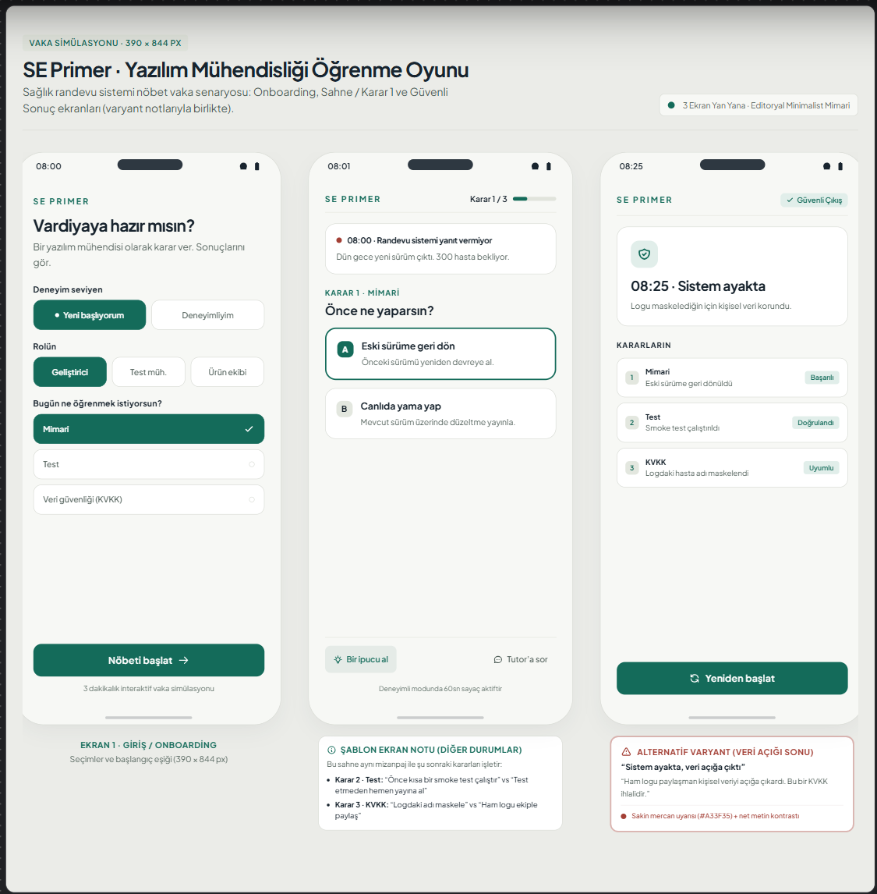

# SE Primer — Ödev

YZM301 için geliştirilen, yazılım mühendisliği kararlarını kısa bir vaka simülasyonuyla öğreten mobil uyumlu öğrenme oyunu.

Ödev deposu herkese açıktır: https://github.com/Salih5400/se-primer-odev

## Tasarım

Ayrı ekranlar: [Giriş](design/assets/onboarding.png) · [Sahne](design/assets/scene.png) · [Son](design/assets/ending.png)

Stitch projesi: https://stitch.withgoogle.com/projects/10280267099388934499

## Ürün kapsamı

- [Ürün spesifikasyonu](spec.md)
- [Tasarım sistemi ve ekran davranışları](DESIGN.md)
- [Stitch için kullanılan prompt](design/stitch-prompt.md)

## Uygulama ve kanıtlar

- React/Vite mobil uyumlu prototip ve Express tutor API: `npm install`, ardından `npm run dev`. Gemini anahtarı isteğe bağlıdır; anahtar yoksa veya Gemini kotası/bağlantısı kullanılamıyorsa API karar konusuna uygun çevrimdışı yedek tutor ipucu verir.
- Tutor değerlendirmesi: [20 sentetik yanıt ve etiketleme yönergesi](eval/README.md), [yedek tutor değerlendirme raporu](eval/tutor-evaluation.md); API yanıtlarını `npm run eval:tutor` ile üretin.
- Cypress E2E: `npm run test:e2e` ile 8 karar yolunu, tutor/yedek tutor, ipucu, 60 saniyelik sayacı ve yeniden başlatmayı kapsar (12 test).
- Kısa demo kaydı: [10,8 saniyelik uygulama akışı](demo/se-primer-e2e.mp4) (Cypress kayıt videosu; anlatımlı sunum kaydı değil).
- Google AI Studio uygulaması: [SE Primer](https://aistudio.google.com/apps/d0ee75f8-fc12-4804-be2c-4e630190cfec) (bağlantıya sahip herkes görüntüleyebilir).
- AI Studio önizlemesinde 429 kota aşımında güvenli yedek ipucu gösterimi doğrulandı. Yerel Express tutor API'si de anahtar yokluğu, kota/hizmet hatası ve zaman aşımında karar konusuna uygun yedek ipucuna döner; Gemini yanıtları ayrıca kaynak etiketiyle raporlanır.

## Doğrulama durumu

- Sunucu ve eval betiği Node.js sözdizimi kontrolünden geçti; 20 eval girdisi JSON olarak doğrulandı.
- AI Studio'da sentetik tutor sorusu gönderildi; Gemini `429 RESOURCE_EXHAUSTED` döndürdü, arayüz yedek yanıtı gösterdi ve yükleme durumu kapandı. 20 model yanıtı değerlendirmesi henüz yapılmadı.
- `npm install` ve `npm run build` başarıyla tamamlandı. Cypress E2E: **12/12 geçti**. Çevrimdışı yedek tutor'ın 20 sentetik vakası **20/20 HTTP 200** döndürdü; elle değerlendirme raporu yukarıda. Gemini kotası yüzünden gerçek modelin 20 yanıtı ayrıca puanlanamadı.

## Ürün kararları

- **Kullanıcı hesabı eklemedim:** kısa, tek oturumluk öğrenme akışı için hesap ve kalıcı profil gerekmiyor.
- **İkinci bölüm eklemedim:** ilk sürümün kapsamını tek bir vaka ve üç kararla sınırlayarak temel etkileşimi değerlendirmeyi kolaylaştırıyorum.
- **Native mobil uygulama yapmadım:** telefonda tarayıcıdan çalışmak ödevin mobil kullanım hedefini karşılıyor ve mağaza dağıtımı gerektirmiyor.

## Not

Senaryo eğitim amaçlıdır ve hiçbir gerçek hasta verisi içermez.
