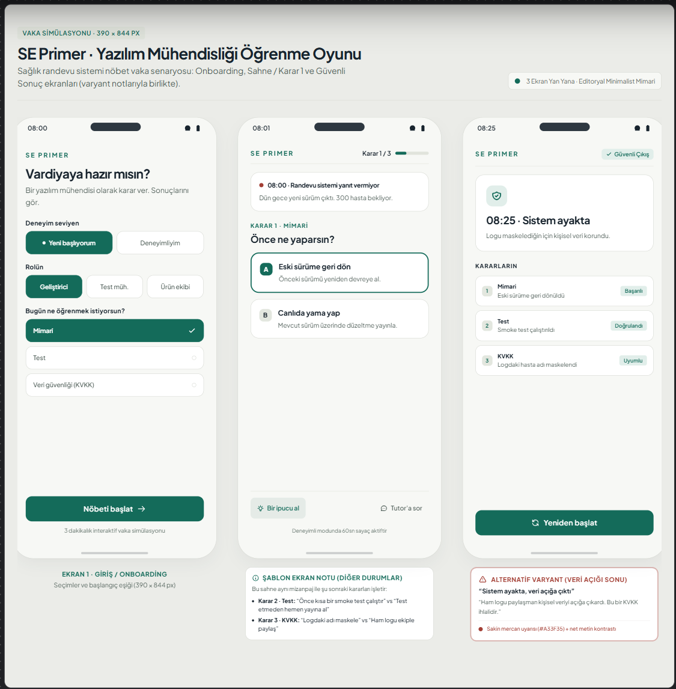

# SE Primer — Ödev

YZM301 için geliştirilen, yazılım mühendisliği kararlarını kısa bir vaka simülasyonuyla öğreten mobil uyumlu öğrenme oyunu.

Ödev deposu herkese açıktır: https://github.com/Salih5400/se-primer-odev

## Tasarım

Ayrı ekranlar: [Giriş](design/assets/onboarding.png) · [Sahne](design/assets/scene.png) · [Son](design/assets/ending.png)

Stitch projesi: https://stitch.withgoogle.com/projects/10280267099388934499

## Ürün kapsamı

- [Ürün spesifikasyonu](spec.md)
- [Tasarım sistemi ve ekran davranışları](DESIGN.md)
- [Stitch için kullanılan prompt](design/stitch-prompt.md)

## The Primer v2 veri toplama

Canlı veri toplama sayfası: https://salih5400.github.io/se-primer-odev/?collect=1 (GitHub Pages dağıtımı tamamlandıktan sonra açılır).

- Yerelde `npm install` ve `npm run dev` çalıştırın; sonra `http://localhost:5173/?collect=1` adresini açın. GitHub Pages dağıtımı açıldığında aynı modu canlı linkin sonuna `?collect=1` ekleyerek kullanabilirsiniz.
- Üç farklı katılımcı beşer oturum oynasın. Her kişi oturum başına rıza kutusunu işaretlesin; her kararın geri bildirim ekranında “ipucuna ihtiyaç duydun mu?” sorusunu yanıtlasın. Katılımcılar farklı cihaz kullanırsa her cihazdan CSV dışa aktarın ve dosyaları birleştirin.
- Finalde **CSV dışa aktar** düğmesini kullanın. Gerçek katılımcı CSV satırlarını `data/oturumlar.csv` başlığıyla birleştirin. Cypress testlerindeki `kaynak=sentetik` satırları eğitime girmez.
- Uygulama ad, e-posta, cihaz kimliği, IP, konum veya serbest metin toplamaz. Oturumlar rastgele kimlikle ilişkilendirilir ve yalnızca tarayıcıda tutulur.

Model hedefi, özellik sırası ve eğitimden önce sabitlenen kabul eşikleri [spec.md](spec.md)'de; CSV sütunlarının tanımı [data/SOZLUK.md](data/SOZLUK.md)'dedir.

### ML eğitimi

Python 3.12 kullanın. `.venv` oluşturup [requirements-ml.txt](requirements-ml.txt)'deki sürümleri kurun, sonra `python train.py` çalıştırın. Betik en az 15 tam gerçek oturum ve önceden belirlenen eval eşiği olmadan model üretmez. Eşik geçilirse `model/` ve `tests/parite.json` üretilir.

### Tarayıcı çıkarımı ve test kahini

Yayımlanan model, `public/model/release.json` içindeki tam Hugging Face commit URL'sinden tarayıcıda ONNX Runtime Web ile çalışır. `?parity=1` sayfası aynı beş referans girdiyi tarayıcıda çalıştırır; `npm run test:e2e` Python Oracle sonuçlarına karşı `1e-4` toleransını denetler. Model kapalıysa uygulama mevcut Primer akışını korur.

## Uygulama ve kanıtlar

- React/Vite mobil uyumlu prototip ve Express tutor API: `npm install`, ardından `npm run dev`. Gemini anahtarı isteğe bağlıdır; anahtar yoksa veya Gemini kotası/bağlantısı kullanılamıyorsa API karar konusuna uygun çevrimdışı yedek tutor ipucu verir.
- Tutor değerlendirmesi: [20 sentetik yanıt ve etiketleme yönergesi](eval/README.md), [yedek tutor değerlendirme raporu](eval/tutor-evaluation.md); API yanıtlarını `npm run eval:tutor` ile üretin.
- Cypress E2E: `npm run test:e2e` ile 8 karar yolunu, tutor/yedek tutor, rıza ve anonim kayıt, beş girdilik parite kahini, ipucu, 60 saniyelik sayacı ve yeniden başlatmayı kapsar (15 test).
- Google AI Studio uygulaması: [SE Primer](https://aistudio.google.com/apps/d0ee75f8-fc12-4804-be2c-4e630190cfec) (bağlantıya sahip herkes görüntüleyebilir).
- AI Studio önizlemesinde 429 kota aşımında güvenli yedek ipucu gösterimi doğrulandı. Yerel Express tutor API'si de anahtar yokluğu, kota/hizmet hatası ve zaman aşımında karar konusuna uygun yedek ipucuna döner; Gemini yanıtları ayrıca kaynak etiketiyle raporlanır.

## Doğrulama durumu

- Sunucu ve eval betiği Node.js sözdizimi kontrolünden geçti; 20 eval girdisi JSON olarak doğrulandı.
- AI Studio'da sentetik tutor sorusu gönderildi; Gemini `429 RESOURCE_EXHAUSTED` döndürdü, arayüz yedek yanıtı gösterdi ve yükleme durumu kapandı. 20 model yanıtı değerlendirmesi henüz yapılmadı.
- `npm install` ve GitHub Pages taban yoluyla `npm run build` başarıyla tamamlandı. Cypress E2E: **15/15 geçti**. Çevrimdışı yedek tutor'ın 20 sentetik vakası **20/20 HTTP 200** döndürdü; elle değerlendirme raporu yukarıda. Gemini kotası yüzünden gerçek modelin 20 yanıtı ayrıca puanlanamadı. v2 ONNX modeli henüz üretilmedi; gerçek katılımcı verisi ve önceden tanımlı eval kapısının geçilmesi bekleniyor.

## Ürün kararları

- **Kullanıcı hesabı eklemedim:** kısa, tek oturumluk öğrenme akışı için hesap ve kalıcı profil gerekmiyor.
- **İkinci bölüm eklemedim:** ilk sürümün kapsamını tek bir vaka ve üç kararla sınırlayarak temel etkileşimi değerlendirmeyi kolaylaştırıyorum.
- **Native mobil uygulama yapmadım:** telefonda tarayıcıdan çalışmak ödevin mobil kullanım hedefini karşılıyor ve mağaza dağıtımı gerektirmiyor.

## AI araçları ve öğrenci katkısı

AI kodlama asistanı React/Vite uygulamasının, testlerin, veri toplama akışının, model eğitim/ONNX dışa aktarma betiğinin ve teknik dokümantasyonun hazırlanmasında kullanıldı. Öğrenci ürün kararlarını ve veri etiketini belirledi, uygulamayı gerçek katılımcılarla çalıştırıp toplanan veriyi gözden geçirmeli; model/eval sonuçlarını, lisansları ve bu depodaki kodu teslimden önce inceleyip açıklayabilmelidir. Bu depodaki kullanıcı verisi gerçek katılımcı rızasıyla elde edilmelidir; sentetik test kayıtları eğitim verisi olarak kullanılmaz.

## Not

Senaryo eğitim amaçlıdır ve hiçbir gerçek hasta verisi içermez.
