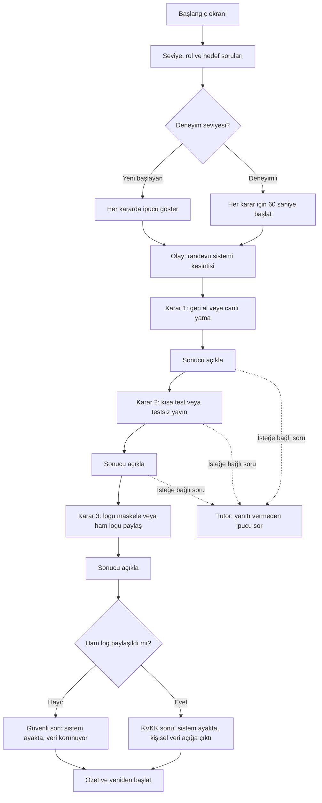

# SE Primer — Ödev | Ürün ve kabul spesifikasyonu

## Problem
Yazılım mühendisliği öğrencileri; mimari, test ve kişisel veri kararlarının canlı bir sistemde nasıl sonuçlandığını yalnızca teorik anlatımdan öğrenmekte zorlanabilir. Bu mobil uyumlu, kısa anlatı tabanlı öğrenme deneyimi, oyuncuya bir sağlık randevu sistemi kesintisi sırasında üç karar verdirir ve her kararın teknik sonucunu açıklar. Gerçek hasta verisi kullanılmaz.

## Hedef kullanıcı ve değer
- **Hedef:** Yazılım mühendisliği öğrencileri; başlangıç düzeyinden deneyimli seviyeye kadar.
- **Değer:** Tek bir 5–8 dakikalık senaryoda geri alma/yama, test ve KVKK açısından güvenli log paylaşımı kararlarını deneyimleyip sonuçlarını görür.
- **Başarı ölçütü:** Kullanıcı, üç kararı tamamlayıp karar sonuçları ve bir final ekranı görür; tutor doğrudan cevabı vermeden düşünmesini destekler.

## Ürün kapsamı
### Dahil
- Telefonda kullanılabilir, tarayıcıda çalışan uygulama.
- Başlangıçta üç kişiselleştirme sorusu: deneyim seviyesi, rol, öğrenme hedefi.
- Tek sağlık randevu sistemi olay örgüsü: gece dağıtımından sonra sistem kesintisi ve bekleyen 300 hasta.
- Üç ikili karar: (1) geri alma veya canlı yama, (2) kısa test veya testsiz yayına alma, (3) logu maskeleme veya ham logu ekiple paylaşma.
- Her seçimden hemen sonra, seçimin teknik/operasyonel etkisini açıklayan kısa geri bildirim.
- İki final: sistemin çalıştığı ve verinin korunduğu güvenli sonuç; sistemin çalıştığı ancak kişisel verinin açığa çıktığı KVKK ihlali sonucu.
- Kural tabanlı veya AI destekli, cevabı açıklamayan Sokratik tutor.
- Başlangıç seviyesindeki oyuncuya her kararda ipucu; deneyimli oyuncuya her karar için 60 saniyelik süre.
- Oturum içinde ilerleme ve yeniden başlatma.

### Kapsam dışı
- Kullanıcı hesabı, kimlik doğrulama veya bulut profili.
- İkinci bölüm, ek senaryo veya serbest dolaşımlı oyun.
- Gerçek hasta verisi, gerçek kişisel veri veya gerçek sağlık sistemi bağlantısı.
- Native iOS/Android uygulaması ya da uygulama mağazası dağıtımı.
- Tutor'un tıbbi, hukuki veya gerçek olay müdahalesi tavsiyesi vermesi.
- Kullanıcıya özel kalıcı analitik, liderlik tablosu veya çok oyunculu özellik.

## Akış şeması

## Davranış kuralları
1. Her oturumda aynı temel olay örgüsü ve üç karar sırası kullanılır.
2. İlk iki karar, final durumunu tek başına değiştirmez; seçim sonuçları ilgili geri bildirimde ve final özetinde görünür. Bu sayede brief'teki iki final korunurken kararların sonuçları da anlamlı kalır.
3. Üçüncü kararda ham log paylaşımı KVKK ihlali finaline; maskeleme güvenli finale götürür. Ekranda gerçek ad/kimlik yerine sentetik örnek gösterilir.
4. Tutor, oyuncunun gerekçesini sorar ve en fazla bir kavramsal ipucu verir. Doğru seçeneği açıkça söylemez; oyuncu seçim yapmadan finali açıklamaz.
5. Süre dolarsa deneyimli oyuncu için karar varsayılan olarak “kısa test yap” ve “logu maskele” güvenli seçeneklerine alınır; arayüz bu otomatik seçimi belirtir. Karar 1 için varsayılan “geri al”dır. Oyuncu isterse süre dolmadan seçebilir.
6. Kişiselleştirme yanıtları yalnızca oturum belleğinde tutulur; sayfa yenilenince silinir.

## Kabul örnekleri
### 1. Kişiselleştirme ve uyarlama
**Verilen:** Kullanıcı uygulamayı açar. **Ne zaman:** Başlangıç sorularını yanıtlar. **O zaman:** Seviye, rol ve hedef alanları tamamlanmadan sahne başlamaz; yeni başlayan seçilirse üç kararda ipucu görünür, deneyimli seçilirse her karar için 60 saniye sayacı başlar. Yanıtlar oturum dışında saklanmaz.

### 2. Üç karar ve seçim sonrası geri bildirim
**Verilen:** Kullanıcı sahneye ulaşır. **Ne zaman:** Üç kararın her birinde bir seçenek seçer. **O zaman:** Seçim kaydedilir, o karara özgü teknik/operasyonel sonuç gösterilir ve sonraki karar açılır. Geri bildirim, kararın nedenini en az bir somut sonuçla açıklar.

### 3. İki final ve kişisel verinin korunması
**Verilen:** Kullanıcı üçüncü karara ulaşır. **Ne zaman:** Logu maskeleme veya ham logu paylaşmayı seçer. **O zaman:** Maskeleme güvenli finale; ham log paylaşımı KVKK ihlali finaline götürür. Her iki finalde sistemin durumu, veri durumu ve seçim zincirinin kısa özeti görünür. Gerçek kişisel veri hiçbir yerde bulunmaz.

### 4. Tutor'un sınırı
**Verilen:** Kullanıcı bir karar ekranındadır. **Ne zaman:** Tutor'dan yardım ister. **O zaman:** Tutor, doğru seçeneği veya finali söylemeden en fazla bir ipucu sorusu/yanıtı verir; yardım almadan da karar akışı tamamlanabilir.

### 5. Tamamlama, yeniden başlatma ve mobil kullanılabilirlik
**Verilen:** Uygulama desteklenen güncel bir mobil tarayıcıda açılır. **Ne zaman:** Kullanıcı baştan sona oynar ve final ekranına ulaşır. **O zaman:** Yatay kaydırma olmadan metin ve iki seçenek kullanılabilir; final özeti ile yeniden başlatma sunulur. Yeniden başlatma kişiselleştirme ve kararları temizler ve yeni bir oturum başlatır.

## Ölçülecek kalite koşulları
- Üç kararın tüm seçenekleri erişilebilir ve klavye/dokunmatik ile seçilebilir.
- Tutor'un cevabı ele verip vermediği, 20 sentetik öğrenci yanıtıyla elle etiketlenir; sonuçta hata türleri, oran ve payda raporlanır.
- Cypress E2E testi güvenli ve KVKK ihlali dahil tüm karar yollarını kapsar; demo videosu en fazla 60 saniyedir.
- Uygulama ve örnekler eğitim amaçlıdır; gerçek kişisel veri içermez.

## Varsayımlar ve açık noktalar
- Rol ve hedef soruları kişiselleştirme için kullanılacak; farklı rol/ hedef kombinasyonları ayrı dallar üretmeyecek.
- Deneyim seviyesi, yönergedeki ipucu/süre uyarlamasını belirler.
- Atanmış son teslim günü sunumda boş bırakılmış (`[__ Ekim 2026, 23:59]`); repo/AI Studio/video linkleri son teslimden önce README'de yer almalı.
